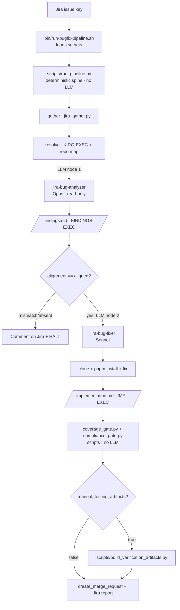

# Jira → GitLab Agentic Bug-Fixer

An agentic pipeline on **Kiro CLI** that turns a Jira bug ticket into a review-ready GitLab merge
request. It reads the ticket's full history, **independently verifies** the root cause, implements
the fix under strict team standards, runs tests + coverage, and raises compliant MRs — with human
gates where they matter.

Two LLM agents (an **Opus** analyzer and a **Sonnet** fixer) driven by a **deterministic Python
spine** (`scripts/run_pipeline.py`). LLM tokens are spent only on the two judgment steps
(verify the root cause, write the fix); all control flow, repo resolution, gating, and the
coverage/compliance checks run as scripts at 0 credits. See
[`docs/ORCHESTRATION-AUDIT.md`](docs/ORCHESTRATION-AUDIT.md) for the design rationale.

---

## Contents

1. [What it does](#what-it-does)
2. [Architecture](#architecture)
3. [Repository layout](#repository-layout)
4. [Prerequisites](#prerequisites)
5. [Install](#install)
6. [Running it](#running-it)
7. [The KIRO-EXEC spec](#the-kiro-exec-spec)
8. [Multi-repo & shared packages](#multi-repo--shared-packages)
9. [Guardrails](#guardrails)
10. [Outputs](#outputs)
11. [Troubleshooting](#troubleshooting)
12. [Roadmap](#roadmap)

Deeper docs: [`docs/ARCHITECTURE.md`](docs/ARCHITECTURE.md) (design + rationale),
[`docs/SETUP.md`](docs/SETUP.md) (detailed first-run + troubleshooting).

---

## What it does

Given a Jira issue key, one command runs the whole pipeline. The Python spine sequences the steps
and calls the LLM at only two of them:

1. **Gather** (script) — pulls the code-fix ticket, every linked/mentioned upstream ticket (ops
   reports, prior fixes), and all comments, sorted into one timeline.
2. **Resolve** (script) — parses the ticket's `KIRO-EXEC` block and resolves repos from the
   component→repo map. No LLM.
3. **Analyze (Opus, read-only)** — treats the ticket's "Proposed Solution" as a *hypothesis*. It
   clones the repo(s), greps every reference/call-site of the buggy code, traces data flow, entry
   points and feature flags, and writes an evidence-based root cause to `findings.md` with an
   `alignment: aligned|mismatch` marker. On a mismatch it **comments on the ticket and halts**.
4. **Gate** (script) — reads `FINDINGS-EXEC.alignment`; the fixer runs only when `aligned`.
5. **Fix (Sonnet)** — implements the approved findings, enforcing coding, unit-test, and MR
   standards as **hard gates**; opens compliant MR(s); writes `implementation.md`.
6. **Coverage + compliance** (scripts) — the spine independently re-runs jest for before/after
   coverage (no-regression) and greps the changed files for standards violations.
7. **(Optional) Verification pack** — scenarios (bug-fix, regression, feature-flag on/off), the exact
   API + payload to hit, and assertions — rendered as a guide + OpenAPI + Postman collection.

---

## Architecture



**Why two agents + a spine.** Kiro binds one model per agent and can't switch mid-run, so
Opus-analysis + Sonnet-fix requires two agent configs. The former Haiku orchestrator that ran them
as subagents did zero reasoning, so it was retired: a deterministic Python driver
(`run_pipeline.py`) now owns the sequence and calls each agent as a plain subprocess, keeping the
model split while spending 0 credits on control flow. Credits: Opus 2.20× · Sonnet 1.30× · scripts 0×.

**Auth model (agent vs. script — mirror images):**

| System | Agent uses | Script uses |
| --- | --- | --- |
| Jira | Rovo MCP (OAuth) — reads + comments + subtasks | Jira REST API token (Basic auth) — read-only gather |
| GitLab | GitLab MCP (`create_merge_request`, reads) | PAT in the clone URL — git clone/push |

---

## Repository layout

```
jira-gitlab-bugfix-agents/
├── README.md                     ← this file
├── deploy.sh                     ← installs everything (portable, idempotent)
├── agents/                       → ~/.kiro/agents/
│   ├── jira-bug-analyzer.json     / -prompt.md        (Opus, read-only)
│   ├── jira-bug-fixer.json        / -prompt.md        (Sonnet)
│   ├── unit-test-writer.json      / -prompt.md        (Sonnet, standalone test writer)
│   ├── jira-bug-template-kiro.md         (KIRO-EXEC spec — agent resource)
│   ├── component-repo-mapping-kiro.md    (Component/package → repo map)
│   └── merge-request-process-vpt.md      (VPT MR process)
├── steering/                     → ~/.kiro/steering/
│   ├── coding-guideline.md               (fileMatch **/*.ts)
│   └── unit-test-guidelines.md           (fileMatch **/*.test.ts)
├── config/
│   └── mcp.example.json          → ~/.kiro/settings/mcp.json (customize local paths)
├── scripts/                      → ~/my-projects/jira-bug-fixer/scripts/
│   ├── run_pipeline.py                   (the deterministic spine / entry driver)
│   ├── pipeline_lib.py                   (parsers: KIRO-EXEC, repo map, gate readers)
│   ├── jira_gather.py                    (Jira history ETL, stdlib only)
│   ├── coverage_gate.py                  (before/after jest coverage, no-regression)
│   ├── compliance_gate.py               (scripted lint + unit-test standard checks)
│   └── build_verification_artifacts.py   (renders guide/OpenAPI/Postman)
├── bin/                          → ~/my-projects/jira-bug-fixer/
│   ├── run-bugfix-pipeline.sh            (thin launcher → run_pipeline.py)
│   ├── run-bug-fixer-interactive.sh      (fixer only, no API key)
│   ├── run-bug-fixer.sh                  (fixer only, headless)
│   └── run-unit-test-writer.sh           (standalone test writer)
└── docs/
    ├── ARCHITECTURE.md
    └── SETUP.md
```

The agent configs use a `__KIRO_HOME__` placeholder for absolute resource paths; `deploy.sh`
substitutes each developer's real `~/.kiro` at install time, so the repo is portable across the team.

---

## Prerequisites

- **Kiro CLI** (`kiro-cli version`), logged in (`kiro-cli whoami`). The spine calls the analyzer
  and fixer as ordinary agent subprocesses — no subagent support required.
- **git**, **Node + pnpm** (the target repos use pnpm).
- **Python 3** (system Python is fine — scripts are stdlib-only, no venv).
- **GitLab PAT** (`api`, `read_repository`, `write_repository`).
- **Jira API token** + Atlassian email + site URL.

---

## Install

```bash
git clone <this-repo> && cd jira-gitlab-bugfix-agents

# 1) Secrets in the macOS keychain (never inline)
security add-generic-password -s gitlab-pat          -a "$USER" -w   # GitLab PAT
security add-generic-password -s atlassian-email     -a "$USER" -w   # Atlassian email
security add-generic-password -s atlassian-api-token -a "$USER" -w   # Jira API token
security add-generic-password -s jira-base-url       -a "$USER" -w   # https://<site>.atlassian.net

# 2) Install everything into ~/.kiro and ~/my-projects/jira-bug-fixer
./deploy.sh

# 3) Customize the MCP config for YOUR machine
#    Edit ~/.kiro/settings/mcp.json — set your workflow-mcp-server dist path, uvx path, AWS_PROFILE.
```

`deploy.sh` validates all three agents and reminds you of the keychain items. Re-run it any time to
pull in updates.

---

## Running it

### Full pipeline (analyze → fix)

```bash
cd ~/my-projects/jira-bug-fixer
./run-bugfix-pipeline.sh DT-46443 --prefixes DT,VP
```

The spine runs gather → resolve → analyze → gate → fix → coverage → compliance → report, calling
the analyzer and fixer at only the two LLM steps. Each step checkpoints to a file, so a re-run
resumes at the first missing output; `--force` redoes everything and `--from <step>` resumes at a
named step. Setting `KIRO_API_KEY` runs the agents headless (non-interactive).

### Fixer only (skip the analyzer)

```bash
./run-bug-fixer-interactive.sh DT-46443   # uses spec_source from the ticket's KIRO-EXEC
```

### Demo script (10 min)

1. Show a ticket with a `KIRO-EXEC` block at `autonomy: propose`.
2. Run the pipeline; narrate Phase 0 building the timeline.
3. Show the analyzer's `analysis.md` — `file:line` evidence, entry points, regression list.
4. Show a **deliberate mismatch** ticket → the analyzer halts and comments. (This is the trust story.)
5. On an aligned ticket in `propose` mode → it posts the diff + coverage to Jira, opens nothing.
6. Flip to `auto-mr` + `manual_testing_artifacts: true` → show the MR, coverage before/after, and the
   `verification/` folder (import the Postman collection).

---

## The KIRO-EXEC spec

Every agent-eligible ticket carries one fenced block in its Jira **description**.

```yaml
# --- KIRO-EXEC ---
schema_version: 1
autonomy: propose             # propose | auto-mr | auto-merge
primary_repos: [verification-workflow-engine]   # must exist in the component→repo map
context_repos: []
multi_repo: false             # true → one Jira subtask per repo; MR titles use subtask keys
base_branch: develop
target_branch: develop
hotfix: false                 # true → hotfix MR targets master first
cherry_pick_to: []
branch_name: auto             # "auto" → <KEY>-<slug>
reviewers: [anuragmishra1]
tests_required: true
test_command: "pnpm exec jest src/.../X.test.ts --runInBand"
spec_source: analyzer         # analyzer | jira | kiro_spec
spec_branch: ""               # for kiro_spec
spec_path: ""                 # for kiro_spec
manual_testing_artifacts: false
entry_points:
  - repo: verification-workflow-engine
    path: src/handler/rules/ClaimReplacementRevertRule.ts
    symbol: reopenWorkflow
# --- END KIRO-EXEC ---
```

| Attribute | Type | Default | Description |
| --- | --- | --- | --- |
| `schema_version` | int | `1` | Schema version of the block. |
| `autonomy` | enum | `propose` | `propose` = post the diff to Jira, open nothing. `auto-mr` = branch/push/MR + reviewers. `auto-merge` = pre-approved classes only; **never merges**. |
| `primary_repos` | list | — | Repos where edits land; each must resolve to a `type: code` map entry. Unknown ⇒ stop and ask. |
| `context_repos` | list | `[]` | Read-only clones for cross-repo context. |
| `multi_repo` | bool | `false` | `true` ⇒ create a Jira **subtask per repo** (`[<repo>]`-prefixed, inheriting parent fields); each MR title uses its subtask key, not the bug key. |
| `base_branch` | string | — | Fork point. The most important field — never left to inference. |
| `target_branch` | string | = `base_branch` | MR target. |
| `hotfix` | bool | `false` | `true` ⇒ VPT hotfix flow (MR targets `master` first; cherry-picks surfaced for a human). |
| `cherry_pick_to` | list | `[]` | Branches a hotfix propagates to (noted, not auto-applied). |
| `branch_name` | string | `auto` | Keep `auto` to derive from the ticket/subtask key. |
| `reviewers` | list | `[]` | GitLab usernames → `reviewer_ids` via `get_users`; unresolved names are listed in the MR. |
| `tests_required` / `test_command` | bool / string | `true` / `""` | The command that must pass before the MR. |
| `spec_source` | enum | `analyzer` | Where the fixer's plan comes from: `analyzer` brief / `jira` proposal / `kiro_spec` on a branch. |
| `spec_branch` / `spec_path` | string | `""` | Kiro-spec location, for `spec_source: kiro_spec`. |
| `manual_testing_artifacts` | bool | `false` | `true` ⇒ fixer emits a manifest and renders `verification/` (guide + OpenAPI + Postman). Hard-gated: the MR can't open without it. |
| `entry_points` | list | `[]` | `{repo, path, symbol}` fast-locate hints. |

---

## Multi-repo & shared packages

**Multi-repo → Jira subtasks.** When a fix spans several repos, the fixer creates one Jira
**subtask per repo** under the bug (`[<repo>]`-prefixed, inheriting components/priority/labels/
fix-versions/assignee). Each repo's branch and MR title use that repo's **subtask key**, and the
parent bug aggregates them.

**Shared packages (private npm registry).** Cross-repo type/contract changes live in `@dfg/*`
package repos (see the `packages` table in `agents/component-repo-mapping-kiro.md`). When a package
change is needed the fixer:

1. Clones the package repo and **forks a feature branch from `master`** (packages branch off master).
2. Makes the change, **bumps the version**, and **updates `CHANGELOG.md`**.
3. `pnpm build` + `pnpm link --global`; in each consuming repo `pnpm link --global @dfg/<pkg>` and
   bumps the dependency version — so local builds/tests pass before publish.
4. Opens the **package MR into `master`** (publishes on merge) and adds a `⛔ Depends on package MR
   <url>` marker to each consuming MR so they merge in the right order.

---

## Guardrails

- **Independent verification** — the analyzer halts on a mismatch instead of coding.
- **Strict standards as hard gates** — ESLint/Prettier zero-error + no new `eslint-disable`; test
  files grepped for `jest.mock(`/`jest.fn(`/`jest.mocked(`/`.prototype`/`: any`/`: unknown`/`as any`/`as unknown`/logger assertions/`console.log`; MR checklist
  completeness. Non-compliance ⇒ STOP, not a weak MR.
- **Coverage: best-effort, no-regression** — the change fully covers its own new/changed paths and
  must not lower a file's coverage; before/after numbers go in the MR.
- **Never merges, never force-pushes, never touches protected branches directly.**
- **Secrets** come from the keychain, never printed or committed.
- **Human-gated** — propose-by-default, mismatch-halt, human reviewer as the final merge authority.

---

## Outputs

Per run under `/tmp/kiro-bugfix/<ISSUE-KEY>/`: `ticket-history.md`/`.json`, `ticket.md`,
`analysis.md`, `findings.md` (analyzer hand-off, always written), and `implementation.md` (fixer
hand-off). On the branch when `manual_testing_artifacts: true`,
under `verification/`: `verification-guide.md`, `openapi.json`, `postman_collection.json`,
`postman_environment.json`, `stats.json`. The local clone is removed on success, kept on a
STOP/failure for inspection.

---

## Troubleshooting

| Symptom | Fix |
| --- | --- |
| `MCP server failed to start` | `kiro-cli mcp status --name <server>`; fix `mcp.json` local paths. |
| Analyzer halts | It wrote `findings.md` with `alignment: mismatch` (see its Jira comment) — a human confirms/corrects the ticket. |
| Fixer: "no aligned findings" | `spec_source: analyzer` but `findings.md` is missing or `alignment: mismatch`. Use `spec_source: jira` or fix the ticket. |
| Spine can't find the component map | Set `KIRO_BUGFIX_MAP` to the map path, or ensure it's at `~/.kiro/agents/component-repo-mapping-kiro.md`. |
| Repo resolution stop | Component missing from the map, or marked `type: area`. |
| Tool prompts during a run | Tool-name mismatch — reconcile `mcp.json` autoApprove and agent `allowedTools` with `/tools`. |
| Jira gather auth/timeout | Check the four keychain items; on timeout confirm VPN/proxy (the script prints a hint). |

---

## Unit Test Writer Agent

A standalone agent that writes comprehensive unit tests for any source file in the team's repos,
following VPT unit-test guidelines strictly. It runs independently of the bug-fixer pipeline — no
Jira ticket required.

### Usage

```bash
cd ~/my-projects/jira-bug-fixer

# Basic: write tests locally (no MR)
./run-unit-test-writer.sh verification-workflow-engine src/handler/Dependency/DependencyHandler.ts

# Open an MR with the tests
./run-unit-test-writer.sh verification-request src/modules/claimItem/ClaimItemService.ts --open-mr

# Specify a branch
./run-unit-test-writer.sh applicant-service src/modules/applicant/ApplicantService.ts --branch develop

# Multiple files (comma-separated)
./run-unit-test-writer.sh verification-workflow-engine \
  "src/handler/Dependency/DependencyHandler.ts, src/handler/Dependency/IACreationTaskHandlerV2.ts"
```

### What it does

1. Resolves the repo from the component→repo mapping.
2. Clones and installs (`pnpm install`).
3. Reads the source file, traces its dependencies and boundaries.
4. Writes tests using `jest.spyOn` only (no `jest.mock`/`jest.fn`), mock data in separate files,
   typed factories, AAA pattern — all per the `unit-test-guidelines.md`.
5. Runs the tests + coverage scoped to the source file.
6. Self-checks compliance (no `any`, no logger assertions, no private access).
7. Optionally pushes and opens an MR with coverage numbers in the description.

### Standards enforced (hard gates)

- `jest.spyOn` only — no `jest.fn()`, `jest.mocked()`, or `jest.mock(...)`; no `.prototype` and no
  `require(...)` inside a spy.
- Mock only necessary functions at the boundary; all external deps (DB, API, file I/O) mocked; never
  mock private functions.
- No `: any` / `: unknown` and no `as any` / `as unknown` casts.
- No types/interfaces/functions defined inside the test file — import types from the source.
- Constants and mock data always in a separate `.json` file.
- No logger assertions and no `console.log`.
- Common setup in `beforeEach`; AAA structure, one behaviour per `it`, descriptive names.

---

## Roadmap

- Headless + scheduled/webhook (cloud) runs once the org enables Kiro API keys / Kiro Web.
- `story-implementer` sibling agent for greenfield stories (reuses the shared machinery).
- Deeper assertions (audit-trail/DB checks via workflow-mcp-server) in the verification pack.
- Real GitLab MR "depends-on" once exposed by the MCP (today it's a description marker).
