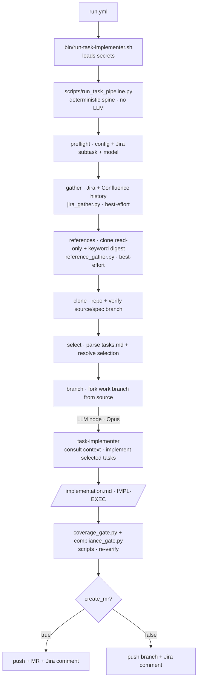

# Jira → GitLab Agentic Task Implementer

A spec-driven sibling of [`jira-gitlab-bugfix-agents`](../jira-gitlab-bugfix-agents). Where the
bug-fixer starts from a bug ticket and _verifies a root cause_, this tool starts from a **Kiro spec**
(`requirements.md` / `design.md` / `tasks.md`) and **implements selected tasks** of a Jira
**subtask** — then runs the standards gates, pushes a branch, optionally opens a compliant MR, and
comments back on the subtask.

One LLM node does the judgment work (writing the code). A **deterministic Python spine**
(`scripts/run_task_pipeline.py`) does everything else at **0 credits**: parse the config, verify the
Jira subtask, clone the repo, select exactly which tasks to run, prep the branch, and re-run the
coverage + compliance gates. The hard input checks happen _before_ any token is spent.

---

## Contents

- [Jira → GitLab Agentic Task Implementer](#jira--gitlab-agentic-task-implementer)
  - [Contents](#contents)
  - [What it does](#what-it-does)
  - [Architecture](#architecture)
  - [Repository layout](#repository-layout)
  - [Install](#install)
  - [Running it](#running-it)
  - [The run config](#the-run-config)
  - [Task selection (precedence rules)](#task-selection-precedence-rules)
  - [References \& grounding context](#references--grounding-context)
  - [Jira + Confluence gather](#jira--confluence-gather)
  - [Gates](#gates)
  - [Model selection](#model-selection)
  - [Multiple MRs for one subtask](#multiple-mrs-for-one-subtask)
  - [Outputs](#outputs)
  - [Troubleshooting](#troubleshooting)

Deeper docs: [`docs/ARCHITECTURE.md`](docs/ARCHITECTURE.md), [`docs/SETUP.md`](docs/SETUP.md).

---

## What it does

Given one per-run YAML config, the spine sequences the pipeline and calls the LLM at only one node:

1. **preflight** (script) — parse + validate the config, confirm the GitLab/Jira secrets, resolve
   the Jira **subtask** (must exist) and its summary (used for the branch name + MR title), and
   resolve the model. Hard gate.
2. **gather** (script) — fetch the full Jira picture — this subtask plus its parent/child/sibling/
   linked tickets, all comments, and the content of linked **Confluence** pages — into
   `ticket-history.md` for grounding. Best-effort (a failure is a warning, not a STOP).
3. **references** (script) — clone the configured reference repos read-only and grep the grounding
   `keywords` across the reference sources, distilling matched excerpts into
   `reference-context.md`. Best-effort.
4. **clone** (script) — clone the target repo with a token URL (so `origin` can push later), and
   confirm the `source_branch` and the spec `tasks.md` exist. Hard gate.
5. **select** (script) — parse `tasks.md` and resolve exactly which tasks to implement (all / range
   / list, honouring optional + done rules). Empty or invalid selection is a hard gate.
6. **branch** (script) — check out `source_branch` and create the work branch.
7. **implement** (LLM — Opus by default) — consult the gathered context + references, implement the
   selected tasks in order to the coding + unit-test guidelines, run the gate scripts as a pre-push
   hard gate, update + commit `tasks.md` per task, push, open an MR (if `create_mr`), and comment on
   the subtask. Writes `implementation.md`.
8. **coverage + compliance** (scripts) — the spine independently re-runs the coverage-diff and the
   standards checks against the clone (defense in depth).
9. **report** (script) — logs the outcome + where the artifacts are.

---

## Architecture



**Auth model (mirror of the bug-fixer):**

| System | Agent uses                                 | Script uses                                        |
| ------ | ------------------------------------------ | -------------------------------------------------- |
| Jira   | Rovo MCP (OAuth) — reads + comments        | Jira REST token (Basic auth) — read-only preflight |
| GitLab | GitLab MCP (`create_merge_request`, reads) | PAT in the clone URL — git clone/push              |

---

## Repository layout

```
jira-gitlab-task-implementer/
├── README.md
├── deploy.sh                     ← installs everything (portable, idempotent)
├── agents/                       → ~/.kiro/agents/
│   ├── task-implementer.json      / -prompt.md    (Opus by default)
│   └── merge-request-process-vpt.md               (VPT MR process — agent resource)
├── steering/                     → ~/.kiro/steering/
│   ├── coding-guideline.md               (fileMatch **/*.ts)
│   └── unit-test-guidelines.md           (fileMatch **/*.test.ts)
├── config/
│   ├── mcp.example.json          → ~/.kiro/settings/mcp.json
│   └── run.example.yml           ← the per-run config template
├── scripts/                      → ~/my-projects/jira-task-implementer/scripts/
│   ├── run_task_pipeline.py              (the deterministic spine)
│   ├── task_pipeline_lib.py              (config loader, tasks.md parser, selection, model map, url helpers)
│   ├── jira_client.py                    (read-only Jira preflight, stdlib)
│   ├── jira_gather.py                    (Jira + Confluence history ETL, stdlib)
│   ├── reference_gather.py               (read-only reference clone + keyword-grounded digest)
│   ├── coverage_gate.py                  (shared with the bug-fixer)
│   ├── compliance_gate.py                (shared with the bug-fixer)
│   └── build_verification_artifacts.py   (shared with the bug-fixer)
└── bin/
    └── run-task-implementer.sh           (thin launcher → run_task_pipeline.py)
```

The scripts are **stdlib-only Python** (no `pip`/venv needed — PyYAML is used if present, otherwise
a built-in minimal YAML parser handles the config). The agent config uses a `__KIRO_HOME__`
placeholder that `deploy.sh` substitutes at install time.

---

## Install

```bash
# 1) Secrets in the macOS keychain (shared with the bug-fixer; skip any you already have)
security add-generic-password -s gitlab-pat          -a "$USER" -w   # GitLab PAT (api, read/write_repository)
security add-generic-password -s atlassian-email     -a "$USER" -w   # Atlassian email
security add-generic-password -s atlassian-api-token -a "$USER" -w   # Jira API token
security add-generic-password -s jira-base-url       -a "$USER" -w   # https://<site>.atlassian.net

# 2) Install into ~/.kiro and ~/my-projects/jira-task-implementer
./deploy.sh

# 3) If you don't already have it, customize ~/.kiro/settings/mcp.json for your machine.
```

---

## Running it

```bash
cd ~/my-projects/jira-task-implementer
cp config/run.example.yml config/run.yml
$EDITOR config/run.yml           # set jira_id, repo_url, source_branch, spec.path, task selection
./run-task-implementer.sh --config config/run.yml
```

Handy CLI overrides (they win over the file): `--jira DT-1`, `--branch my-branch`, `--model sonnet`.
Re-runs resume at the first missing checkpoint; `--force` redoes everything and `--from <step>`
resumes at a named step (`preflight clone select branch implement coverage compliance report`).
With `KIRO_API_KEY` set the implement agent runs headless; otherwise it uses your `kiro-cli login`
session interactively.

---

## The run config

Every field, with defaults, lives in [`config/run.example.yml`](config/run.example.yml). Summary:

| Field               | Req? | Default           | Meaning                                                                                                           |
| ------------------- | ---- | ----------------- | ----------------------------------------------------------------------------------------------------------------- |
| `jira_id`           | ✅   | —                 | The Jira **subtask** id being implemented (branch name + MR title + final comment).                               |
| `repo_url`          | ✅   | —                 | GitLab repo (https or `git@…`).                                                                                   |
| `source_branch`     | ✅   | —                 | Branch to fork from. Must exist on origin.                                                                        |
| `branch_name`       |      | `auto`            | `auto` ⇒ `<jira_id>-<slug>`. Override to control it (and to make >1 MR per subtask).                              |
| `target_branch`     |      | = `source_branch` | MR target branch.                                                                                                 |
| `spec.location`     |      | `repo`            | `repo` (read `tasks.md` from the repo) or `local` (from your disk).                                               |
| `spec.path`         | ✅   | —                 | Spec folder (repo-relative for `repo`, absolute for `local`).                                                     |
| `spec.branch`       |      | = `source_branch` | (repo mode) branch holding the spec.                                                                              |
| `tasks.optional`    |      | `false`           | Include optional (`[ ]*`) tasks in the **all** selection.                                                         |
| `tasks.range`       |      | —                 | `{from, to}` (or `"from-to"`) — a task range.                                                                     |
| `tasks.list`        |      | —                 | Explicit task ids, run in the given order.                                                                        |
| `references`        |      | none              | Read-only grounding: `keywords`, `repos[]`, `local[]`. See [References](#references--grounding-context).          |
| `jira`              |      | gather on         | Jira/Confluence gather: `gather`, `max_depth`, `max_tickets`, `project_prefixes`, `confluence`, `max_confluence`. |
| `unit_tests`        |      | `true`            | `false` ⇒ skip test-only tasks **and** the coverage gate (takes precedence over the task list).                   |
| `create_mr`         |      | `false`           | `true` ⇒ push + open MR; `false` ⇒ push branch only.                                                              |
| `testing_artifacts` |      | `false`           | `true` ⇒ emit the verification manifest + render the Postman/OpenAPI pack.                                        |
| `test_command`      |      | repo default      | Explicit test command; else `pnpm exec jest --runInBand`.                                                         |
| `model`             |      | `opus`            | `opus` / `sonnet` / `haiku` / `auto` / exact id.                                                                  |
| `reviewers`         |      | `[]`              | GitLab usernames → `reviewer_ids` (best-effort).                                                                  |

> **Quote task ids** (`"15.4"`, not `15.4`). Unquoted, YAML reads `15.4` as a number and `15.10`
> silently becomes `15.1`; the loader rejects unquoted decimal ids with a clear error.

---

## Task selection (precedence rules)

The spine turns `tasks.*` into an ordered, deterministic list. Only **one** mode applies per run;
if more than one is set, **precedence is `list` > `range` > `all`.** In every mode, `[x]` completed
tasks are skipped, and selecting a parent id (e.g. `15`) auto-includes its children (`15.1`, `15.4`…).

| Mode      | Set when                   | What it selects                                                     | Optional (`[ ]*`) tasks                     |
| --------- | -------------------------- | ------------------------------------------------------------------- | ------------------------------------------- |
| **all**   | neither `range` nor `list` | every task, in document order                                       | included **only if** `tasks.optional: true` |
| **range** | `tasks.range.from` + `.to` | the document-order span `[from..to]` inclusive                      | **included** (you chose the boundaries)     |
| **list**  | `tasks.list` non-empty     | exactly those ids, **in the order you listed them** (+ descendants) | **included** (you named them)               |

Rationale for the explicit-selection behaviour: when you name a `range` or a `list`, you are being
deliberate, so optional tasks inside it are honoured rather than silently dropped. `tasks.optional`
is the opt-in only for the bulk **all** selection (matching "run everything, optionally including
optional tasks"). A custom `list` runs in the exact order you give — if your tasks have build-order
dependencies, order them accordingly (the tool obeys your order; it does not reorder for you).

Examples:

```yaml
tasks: {}                                   # all required tasks
tasks: { optional: true }                   # all tasks incl. optional
tasks: { range: { from: "15.1", to: "15.6" } }   # the 15.1–15.6 span (incl. optional inside it)
tasks: { list: ["15.4", "15.2"] }           # 15.4 then 15.2, exactly
tasks: { list: ["15"] }                     # task 15 and all of 15.x
```

---

## References & grounding context

References are read-only material the agent consults so it mirrors real patterns/contracts instead
of guessing. Configure them under `references:`:

```yaml
references:
  keywords: ["InsufficiencyFulfillment", "push model"] # global; applied to every source
  repos:
    - url: "https://gitlab.com/<group>/<reference-repo>"
      branch: "develop" # optional (default: repo's default branch)
      paths: ["src/clients"] # optional: scope the scan (else the whole repo, keyword-gated)
      keywords: ["Fulfillment"] # optional: merged with the global keywords
  local:
    - path: "/Users/me/notes/design.md" # a single file
    - path: "/Users/me/ref-service" # or a directory
      paths: ["src"]
      keywords: ["Widget"]
```

The `references` step clones each ref repo **shallow + read-only** (into `references/repos/<name>`)
and greps the keywords across all sources, distilling the matches — with surrounding context and
`»`-marked hit lines — into `references/reference-context.md`. That digest is what the agent reads
first (grounding without burning tokens crawling repos); the full clones stay available if it needs
more. If a source has no keywords, its explicit `paths` are included wholesale, or (whole repo, no
paths) a file-tree listing with a note to add keywords. **References are never edited or pushed.**
This step is best-effort — a clone failure is a warning, not a STOP.

## Jira + Confluence gather

The `gather` step fetches the full ticket picture for grounding — the subtask plus its parent,
child, sibling, and linked tickets, every comment, and the **content of any linked Confluence
pages** — flattens it to text, and writes one chronological `ticket-history.md` (+ a `.json`
sidecar). It walks the linked-issue graph and also follows ticket keys and Confluence page links
mentioned in text. Controls (`jira:` block):

```yaml
jira:
  gather: true # false => skip entirely
  max_depth: 3 # how far to follow the linked-issue graph
  max_tickets: 40 # safety cap
  project_prefixes: ["DT"] # restrict which ticket keys to follow (optional)
  confluence: true # fetch linked Confluence page bodies (via /wiki/rest/api)
  max_confluence: 20 # cap on Confluence pages fetched
```

Uses the same Atlassian API token as the preflight (it works for both Jira and Confluence on the
same site). Best-effort: a network failure is a warning, not a STOP — the spec remains the source
of truth.

## Gates

**Preflight hard gates (0 credits, before any LLM):** the run STOPs with a clear message if the
config is invalid, `GITLAB_PERSONAL_ACCESS_TOKEN` is missing, the Jira subtask doesn't resolve, the
`source_branch` (or the spec branch) is missing on origin, `tasks.md` is absent, or the task
selection is empty / names unknown ids.

**Quality gates (before the MR):** the implement agent runs `compliance_gate.py` (ESLint + Prettier

- the mechanical unit-test checks) and, when `unit_tests: true`, `coverage_gate.py` (no-regression +
  every added line covered) and must get both to exit 0 before pushing. The spine then re-runs both
  independently after the agent exits — a scripted check an LLM can't fudge. When `unit_tests: false`,
  the coverage gate is skipped entirely.

---

## Model selection

`model` accepts a friendly alias mapped to the exact `kiro-cli` id (see
`task_pipeline_lib.resolve_model`), so the config stays stable as models evolve:

| alias            | resolves to         |
| ---------------- | ------------------- |
| `opus` (default) | `claude-opus-4.8`   |
| `sonnet`         | `claude-sonnet-4.6` |
| `haiku`          | `claude-haiku-4.5`  |
| `auto`           | `auto`              |

Any exact id (e.g. `claude-opus-4.7`) or a future id passes through unchanged. The spine passes the
resolved id to `kiro-cli chat --model`, overriding the agent's default.

---

## Multiple MRs for one subtask

A subtask often ships as several MRs. Because **one run = one branch + one task selection**, you get
multiple MRs by running the tool multiple times with a different `branch_name` and selection each
time — each run checks off its own tasks in `tasks.md` and opens its own MR:

```bash
./run-task-implementer.sh --config run.yml --branch DT-46443-client   # e.g. tasks.list ["15.4"]
./run-task-implementer.sh --config run.yml --branch DT-46443-route    # e.g. tasks.list ["16.1","16.2"]
```

---

## Outputs

Per run under `/tmp/kiro-task/<jira_id>/<branch>/`: `preflight.json`, `ticket-history.md`/`.json`
(Jira + Confluence gather), `references/reference-context.md` + `references/manifest.json` (+ the
read-only clones under `references/repos/`), `tasks.md` (the staged copy), `selected-tasks.json`,
`task-brief.json` (the agent's contract), and `implementation.md` (the implement node's hand-off,
written on every exit). The target-repo clone is kept at `/tmp/kiro-task/<jira_id>/<branch>/<repo>`
for inspection. When `testing_artifacts: true`, the `verification/` pack (guide + OpenAPI + Postman)
is committed on the branch.

### Workspace lifecycle & cleanup

The workspace is **kept by default** — that's what lets a re-run resume at the first missing step
and lets you inspect artifacts (and the reference clones make it large, often hundreds of MB).
**Stopping the agent with Ctrl+C does NOT clean it up:** the agent absorbs the interrupt and exits
cleanly, so the spine finishes and never sees an abort. To manage it:

- **Start clean:** `--fresh` wipes this run's workspace (`/tmp/kiro-task/<jira>/<branch>/`) before
  starting, instead of resuming from checkpoints.
- **Auto-remove on success:** `--cleanup` deletes the workspace after a completed run
  (`status: implemented`); it is kept on any STOP so you can inspect.
- **Manual:** `rm -rf /tmp/kiro-task/<jira_id>` removes everything for a subtask.

```bash
./run-task-implementer.sh --config run.yml --fresh      # ignore any prior workspace, start clean
./run-task-implementer.sh --config run.yml --cleanup    # remove the workspace if the run completes
```

---

## Troubleshooting

| Symptom                                     | Fix                                                                         |
| ------------------------------------------- | --------------------------------------------------------------------------- |
| STOP: `source_branch not found`             | Check `source_branch` — it must exist on origin.                            |
| STOP: `tasks.md not found`                  | Check `spec.path` (and `spec.branch` for repo mode).                        |
| STOP: `selection matched no runnable tasks` | All selected tasks are `[x]` done, or optional and `tasks.optional: false`. |
| STOP: `task id … was parsed as a number`    | Quote your task ids in the YAML: `"15.10"`.                                 |
| STOP: Jira preflight failed                 | Check the four keychain items; on timeout confirm VPN/proxy.                |
| Coverage/compliance gate fails on re-check  | The branch is pushed; a human reviews. See the gate output in the log.      |
| Tool prompts during a run                   | Reconcile `mcp.json` autoApprove + the agent `allowedTools` with `/tools`.  |
