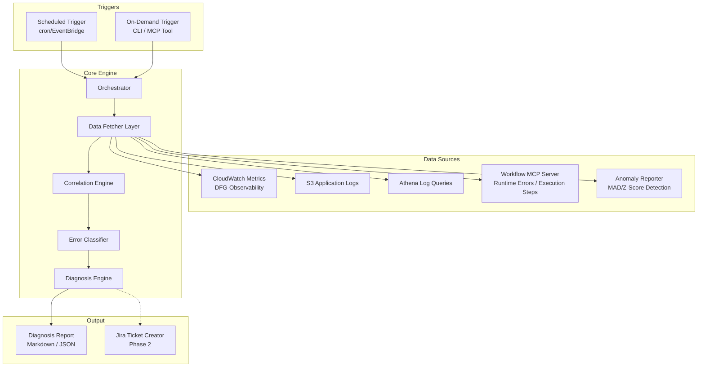
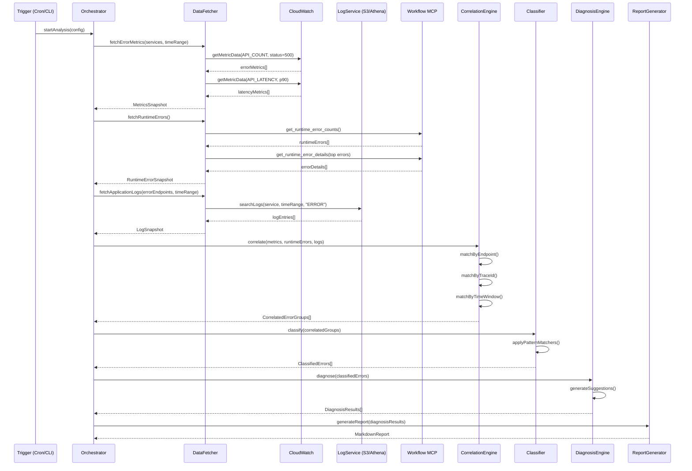
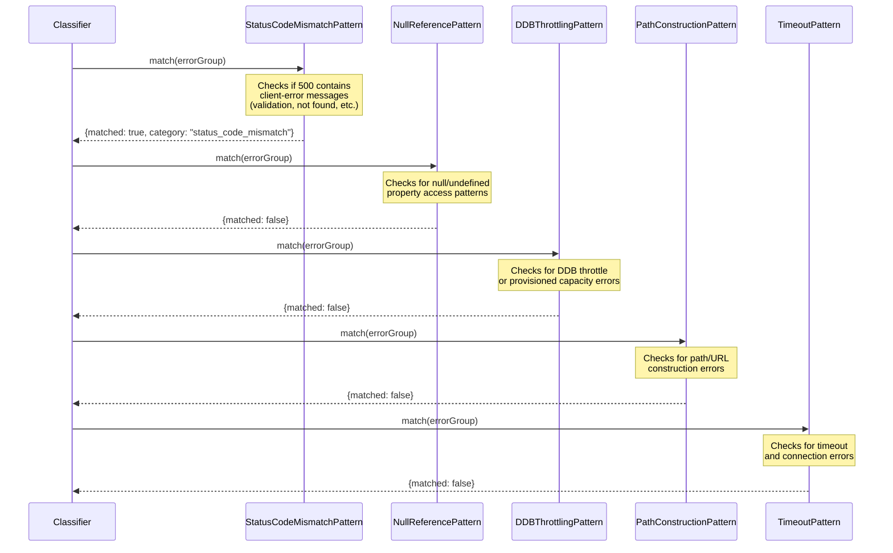

# Design Document: Proactive Error Analyser

## Overview

The Proactive Error Analyser is an automated diagnosis system that correlates error data across CloudWatch metrics, application logs (via S3/Athena), and the workflow runtime engine to identify, classify, and suggest fixes for production issues. It operates on a schedule or on-demand, fetching error counts from CloudWatch (DFG-Observability namespace), downloading and parsing application logs, querying workflow runtime errors, and applying pattern-matching heuristics to classify errors into actionable categories.

The system addresses a key operational pain point: manually correlating errors across multiple data sources is time-consuming and error-prone. By automating this correlation and applying known error pattern signatures (e.g., 500s that should be 400s, null pointer exceptions, DynamoDB throttling), the system produces actionable diagnosis reports with suggested fixes, reducing mean-time-to-resolution.

Phase 1 delivers automated error detection, correlation, classification, and reporting. Phase 2 adds Jira integration for automatic bug ticket creation from confirmed issues.

## Architecture



## Sequence Diagrams

### Main Analysis Flow



### Error Classification Flow



## Components and Interfaces

### Component 1: Orchestrator

**Purpose**: Coordinates the entire analysis pipeline, managing execution order, error handling, and configuration.

**Interface**:
```typescript
interface IOrchestrator {
  startAnalysis(config: AnalysisConfig): Promise<AnalysisResult>;
  startAnalysisForService(service: string, config: AnalysisConfig): Promise<AnalysisResult>;
  getStatus(): AnalysisStatus;
  cancel(): void;
}
```

**Responsibilities**:
- Parse and validate analysis configuration
- Coordinate data fetching from all sources in parallel where possible
- Pass collected data through correlation → classification → diagnosis pipeline
- Handle partial failures gracefully (one source failing doesn't block others)
- Emit progress events for long-running analyses

### Component 2: DataFetcher

**Purpose**: Abstracts data retrieval from multiple sources behind a unified interface.

**Interface**:
```typescript
interface IDataFetcher {
  fetchCloudWatchErrors(params: MetricFetchParams): Promise<MetricsSnapshot>;
  fetchCloudWatchLatency(params: MetricFetchParams): Promise<MetricsSnapshot>;
  fetchRuntimeErrors(): Promise<RuntimeErrorSnapshot>;
  fetchRuntimeErrorDetails(filter: RuntimeErrorFilter): Promise<RuntimeErrorDetail[]>;
  fetchApplicationLogs(params: LogFetchParams): Promise<LogSnapshot>;
  fetchAnomalyReport(params: AnomalyFetchParams): Promise<AnomalySnapshot>;
  fetchExecutionSteps(workflowId: string, timeRange: TimeRange): Promise<ExecutionStep[]>;
}
```

**Responsibilities**:
- Wrap existing tools (cloudwatch-metrics-reports, dev_lib_log_analyser, workflow MCP)
- Handle retries, rate limiting, and pagination
- Normalize data into common internal formats
- Cache results within a single analysis run

### Component 3: CorrelationEngine

**Purpose**: Links error signals across data sources by matching on endpoint, trace ID, time window, and service.

**Interface**:
```typescript
interface ICorrelationEngine {
  correlate(data: CollectedData): CorrelatedErrorGroup[];
}

interface CollectedData {
  metrics: MetricsSnapshot;
  runtimeErrors: RuntimeErrorSnapshot;
  logs: LogSnapshot;
  anomalies?: AnomalySnapshot;
}
```

**Responsibilities**:
- Match CloudWatch error metrics to corresponding log entries by endpoint + time window
- Link workflow runtime errors to application logs via trace IDs
- Group related errors that share the same root cause
- Score correlation confidence (high/medium/low)

### Component 4: ErrorClassifier

**Purpose**: Applies pattern-matching rules to classify correlated error groups into known categories.

**Interface**:
```typescript
interface IErrorClassifier {
  classify(group: CorrelatedErrorGroup): ClassifiedError;
  registerPattern(pattern: IErrorPattern): void;
  getPatterns(): IErrorPattern[];
}

interface IErrorPattern {
  name: string;
  category: ErrorCategory;
  priority: number;
  match(group: CorrelatedErrorGroup): PatternMatchResult;
  getSuggestion(group: CorrelatedErrorGroup): string;
}
```

**Responsibilities**:
- Maintain a registry of error pattern matchers
- Apply patterns in priority order (most specific first)
- Return the best-matching classification for each error group
- Support adding new patterns without modifying existing code

### Component 5: DiagnosisEngine

**Purpose**: Generates actionable diagnosis reports with root cause analysis and suggested fixes.

**Interface**:
```typescript
interface IDiagnosisEngine {
  diagnose(errors: ClassifiedError[]): DiagnosisReport;
}
```

**Responsibilities**:
- Generate human-readable explanations for each classified error
- Suggest specific code fixes or configuration changes
- Prioritize issues by severity and frequency
- Group related issues to avoid duplicate reports
- Bucket diagnosed issues into `ServiceIssueGroup`s (primary grouping by service) and compute the per-service summary (`ServiceSummary[]`) for the report, while retaining each issue's category as a tag

### Component 6: ReportGenerator

**Purpose**: Formats diagnosis results into consumable output formats (Markdown, JSON).

**Interface**:
```typescript
interface IReportGenerator {
  generateMarkdown(report: DiagnosisReport): string;
  generateJSON(report: DiagnosisReport): object;
  generateSummary(report: DiagnosisReport): string;
}
```

**Responsibilities**:
- Render diagnosis results as structured Markdown **grouped by service** — one section per service, each with a per-service rollup header, then its issues ordered by severity descending
- Render each issue with its error category shown as a **tag/label** (categorisation retained as metadata, not used as the top-level grouping)
- Include CloudWatch console links for each error
- Generate executive summary with top issues and a per-service breakdown table
- Output machine-readable JSON for downstream integrations (Jira Phase 2), exposing both the flat `issues` array and the `serviceGroups` structure

## Data Models

### Core Types

```typescript
// --- Configuration ---
interface AnalysisConfig {
  timeRange: TimeRange;
  services: string[];
  namespace: string;  // default: "DFG-Observability"
  errorThreshold: number;  // minimum error count to investigate
  includeLatencyAnalysis: boolean;
  includeAnomalyDetection: boolean;
  outputFormat: "markdown" | "json" | "both";
  maxLogEntries: number;  // cap on log entries per endpoint
}

interface TimeRange {
  start: Date;
  end: Date;
}

// --- Metrics ---
interface MetricsSnapshot {
  service: string;
  timeRange: TimeRange;
  errorMetrics: EndpointErrorMetric[];
  latencyMetrics: EndpointLatencyMetric[];
  fetchedAt: Date;
}

interface EndpointErrorMetric {
  service: string;
  endpoint: string;
  statusCode: number;
  totalCount: number;
  timestamps: Date[];
  values: number[];
  peakCount: number;
  peakTimestamp: Date;
}

interface EndpointLatencyMetric {
  service: string;
  endpoint: string;
  p90Ms: number;
  p99Ms: number;
  avgMs: number;
  maxMs: number;
}
```

```typescript
// --- Runtime Errors ---
interface RuntimeErrorSnapshot {
  errors: RuntimeErrorGroup[];
  fetchedAt: Date;
}

interface RuntimeErrorGroup {
  definitionName: string;
  subType: string;
  stage: string;
  state: string;
  count: number;
  details?: RuntimeErrorDetail[];
}

interface RuntimeErrorDetail {
  workflowId: string;
  traceId?: string;
  errorMessage: string;
  timestamp: Date;
  stage: string;
  state: string;
}

// --- Logs ---
interface LogSnapshot {
  service: string;
  entries: NormalizedLogEntry[];
  fetchedAt: Date;
}

interface NormalizedLogEntry {
  timestamp: Date;
  level: "ERROR" | "WARN" | "INFO" | "DEBUG";
  message: string;
  traceId?: string;
  requestId?: string;
  service: string;
  endpoint?: string;
  statusCode?: number;
  errorType?: string;
  stackTrace?: string;
  raw: Record<string, any>;
}

// --- Anomaly ---
interface AnomalySnapshot {
  anomalies: AnomalyResult[];
  fetchedAt: Date;
}

interface AnomalyResult {
  metricName: string;
  service: string;
  endpoint?: string;
  currentValue: number;
  baselineMedian: number;
  pctChange: number;
  zScore: number;
  isAnomaly: boolean;
}
```

```typescript
// --- Correlation ---
interface CorrelatedErrorGroup {
  id: string;
  service: string;
  endpoint: string;
  errorCount: number;
  timeRange: TimeRange;
  metrics: EndpointErrorMetric[];
  logEntries: NormalizedLogEntry[];
  runtimeErrors: RuntimeErrorDetail[];
  anomalies: AnomalyResult[];
  correlationConfidence: "high" | "medium" | "low";
  correlationMethod: CorrelationMethod[];
}

type CorrelationMethod = "endpoint_match" | "trace_id" | "time_window" | "error_message";

// --- Classification ---
type ErrorCategory =
  | "status_code_mismatch"    // 500 that should be 400
  | "null_reference"          // null/undefined property access
  | "ddb_throttling"          // DynamoDB throttling/capacity
  | "path_construction"       // URL/path building errors
  | "timeout"                 // connection/request timeouts
  | "data_integrity"          // data validation failures
  | "infrastructure"          // ECS/Lambda/network issues
  | "configuration"           // missing config/env vars
  | "unclassified";           // no pattern matched

interface ClassifiedError {
  group: CorrelatedErrorGroup;
  category: ErrorCategory;
  severity: "critical" | "high" | "medium" | "low";
  pattern: string;  // name of the pattern that matched
  confidence: number;  // 0-1 score
  suggestion: string;
  evidence: string[];  // log lines / metrics that support classification
}

// --- Diagnosis ---
interface DiagnosisReport {
  id: string;
  generatedAt: Date;
  timeRange: TimeRange;
  services: string[];
  summary: ReportSummary;
  issues: DiagnosedIssue[];        // flat list; each issue carries service + category
  serviceGroups: ServiceIssueGroup[];  // primary grouping for rendering: issues bucketed by service
  metadata: ReportMetadata;
}

interface ReportSummary {
  totalErrorsAnalyzed: number;
  issuesFound: number;
  criticalCount: number;
  highCount: number;
  mediumCount: number;
  lowCount: number;
  topCategories: { category: ErrorCategory; count: number }[];
  byService: ServiceSummary[];  // per-service rollup (see Requirement 25)
}

// Primary grouping unit for the report: all issues for one service.
interface ServiceIssueGroup {
  service: string;
  errorCount: number;                 // total errors across this service's issues
  issueCount: number;
  severityCounts: { critical: number; high: number; medium: number; low: number };
  categories: ErrorCategory[];        // distinct categories present (kept as tags on issues)
  issues: DiagnosedIssue[];           // ordered by severity descending
}

// Compact per-service line for the summary table.
interface ServiceSummary {
  service: string;
  errorCount: number;
  issueCount: number;
  criticalCount: number;
  highCount: number;
  mediumCount: number;
  lowCount: number;
}

interface DiagnosedIssue {
  id: string;
  title: string;
  category: ErrorCategory;
  severity: "critical" | "high" | "medium" | "low";
  service: string;
  endpoint: string;
  errorCount: number;
  description: string;
  rootCause: string;
  suggestedFix: string;
  evidence: EvidenceItem[];
  cloudWatchLink?: string;
  relatedWorkflowIds?: string[];
}

interface EvidenceItem {
  source: "cloudwatch" | "logs" | "workflow_mcp" | "anomaly";
  description: string;
  data: string;  // formatted log line, metric value, etc.
  timestamp?: Date;
}

interface ReportMetadata {
  analysisId: string;
  duration: number;  // ms
  dataSourcesQueried: string[];
  errorsEncountered: string[];
}
```

**Validation Rules**:
- `AnalysisConfig.timeRange`: end must be after start, max range 7 days
- `AnalysisConfig.services`: non-empty array, each service must be in known services list
- `AnalysisConfig.errorThreshold`: positive integer, minimum 1
- `EndpointErrorMetric.totalCount`: must equal sum of values array
- `CorrelatedErrorGroup.correlationConfidence`: "high" requires trace_id match, "medium" requires endpoint + time_window, "low" is time_window only
- `ClassifiedError.confidence`: 0.0-1.0, threshold for reporting is 0.6

## Algorithmic Pseudocode

### Main Orchestration Algorithm

```typescript
async function runAnalysis(config: AnalysisConfig): Promise<DiagnosisReport> {
  // PRECONDITION: config is validated, services are known, timeRange is valid
  // POSTCONDITION: returns a complete DiagnosisReport or throws with partial results

  const startTime = Date.now();

  // Step 1: Fetch data from all sources in parallel
  const [metricsSnapshots, runtimeSnapshot, anomalySnapshot] = await Promise.allSettled([
    fetchAllServiceMetrics(config.services, config.timeRange, config.namespace),
    fetchRuntimeErrors(),
    config.includeAnomalyDetection ? fetchAnomalyData(config) : null,
  ]);

  // Step 2: Identify high-error endpoints that need log investigation
  const hotEndpoints = identifyHotEndpoints(metricsSnapshots, config.errorThreshold);

  // Step 3: Fetch logs only for hot endpoints (targeted, not blanket)
  const logSnapshots = await fetchLogsForEndpoints(hotEndpoints, config.timeRange, config.maxLogEntries);

  // Step 4: Correlate across data sources
  const collectedData: CollectedData = {
    metrics: metricsSnapshots,
    runtimeErrors: runtimeSnapshot,
    logs: logSnapshots,
    anomalies: anomalySnapshot,
  };
  const correlatedGroups = correlate(collectedData);

  // Step 5: Classify each correlated group
  const classifiedErrors = correlatedGroups.map(group => classify(group));

  // Step 6: Generate diagnosis
  const report = diagnose(classifiedErrors, config, startTime);

  return report;
}
```

### Correlation Algorithm

```typescript
function correlate(data: CollectedData): CorrelatedErrorGroup[] {
  // PRECONDITION: data contains at least one non-empty snapshot
  // POSTCONDITION: each error signal appears in at most one group
  // LOOP INVARIANT: processedSignals grows monotonically, no signal is processed twice

  const groups: CorrelatedErrorGroup[] = [];
  const processedMetrics = new Set<string>();
  const processedLogs = new Set<string>();

  // Phase 1: Group by endpoint (strongest signal)
  for (const metric of data.metrics.errorMetrics) {
    if (processedMetrics.has(metricKey(metric))) continue;

    const matchingLogs = data.logs.entries.filter(log =>
      log.service === metric.service &&
      log.endpoint === metric.endpoint &&
      isWithinTimeWindow(log.timestamp, metric.timestamps, CORRELATION_WINDOW_MS)
    );

    const matchingRuntimeErrors = data.runtimeErrors.errors
      .flatMap(e => e.details || [])
      .filter(detail =>
        detail.errorMessage.includes(metric.endpoint) ||
        matchingLogs.some(log => log.traceId && log.traceId === detail.traceId)
      );

    const matchingAnomalies = (data.anomalies?.anomalies || []).filter(a =>
      a.service === metric.service && a.endpoint === metric.endpoint
    );

    const methods: CorrelationMethod[] = ["endpoint_match"];
    if (matchingLogs.some(l => matchingRuntimeErrors.some(r => r.traceId === l.traceId))) {
      methods.push("trace_id");
    }
    if (matchingLogs.length > 0) methods.push("time_window");

    groups.push({
      id: generateId(),
      service: metric.service,
      endpoint: metric.endpoint,
      errorCount: metric.totalCount,
      timeRange: { start: metric.timestamps[0], end: metric.timestamps.at(-1)! },
      metrics: [metric],
      logEntries: matchingLogs,
      runtimeErrors: matchingRuntimeErrors,
      anomalies: matchingAnomalies,
      correlationConfidence: methods.includes("trace_id") ? "high" :
                             methods.includes("time_window") ? "medium" : "low",
      correlationMethod: methods,
    });

    processedMetrics.add(metricKey(metric));
    matchingLogs.forEach(l => processedLogs.add(logKey(l)));
  }

  // Phase 2: Pick up orphaned runtime errors not yet correlated
  for (const runtimeGroup of data.runtimeErrors.errors) {
    const uncorrelatedDetails = (runtimeGroup.details || []).filter(d =>
      !groups.some(g => g.runtimeErrors.includes(d))
    );
    if (uncorrelatedDetails.length > 0) {
      groups.push({
        id: generateId(),
        service: runtimeGroup.definitionName,
        endpoint: `workflow:${runtimeGroup.stage}/${runtimeGroup.state}`,
        errorCount: uncorrelatedDetails.length,
        timeRange: inferTimeRange(uncorrelatedDetails),
        metrics: [],
        logEntries: [],
        runtimeErrors: uncorrelatedDetails,
        anomalies: [],
        correlationConfidence: "low",
        correlationMethod: ["error_message"],
      });
    }
  }

  return groups;
}
```

### Classification Algorithm

```typescript
function classify(group: CorrelatedErrorGroup): ClassifiedError {
  // PRECONDITION: group has at least one error signal (metric, log, or runtime error)
  // POSTCONDITION: returns exactly one classification (best match or "unclassified")

  const patterns: IErrorPattern[] = getRegisteredPatterns()
    .sort((a, b) => b.priority - a.priority);  // highest priority first

  for (const pattern of patterns) {
    const result = pattern.match(group);
    if (result.matched && result.confidence >= CONFIDENCE_THRESHOLD) {
      return {
        group,
        category: pattern.category,
        severity: computeSeverity(group, pattern.category),
        pattern: pattern.name,
        confidence: result.confidence,
        suggestion: pattern.getSuggestion(group),
        evidence: result.evidence,
      };
    }
  }

  return {
    group,
    category: "unclassified",
    severity: computeSeverity(group, "unclassified"),
    pattern: "none",
    confidence: 0,
    suggestion: "Manual investigation required. Error does not match known patterns.",
    evidence: [],
  };
}

function computeSeverity(
  group: CorrelatedErrorGroup,
  category: ErrorCategory
): "critical" | "high" | "medium" | "low" {
  // Critical: >100 errors/hour OR infrastructure category with anomaly
  if (group.errorCount > 100 || (category === "infrastructure" && group.anomalies.length > 0)) {
    return "critical";
  }
  // High: >50 errors/hour OR DDB throttling
  if (group.errorCount > 50 || category === "ddb_throttling") {
    return "high";
  }
  // Medium: >10 errors/hour
  if (group.errorCount > 10) {
    return "medium";
  }
  return "low";
}
```

## Key Functions with Formal Specifications

### Function 1: identifyHotEndpoints()

```typescript
function identifyHotEndpoints(
  snapshots: MetricsSnapshot[],
  threshold: number
): HotEndpoint[]
```

**Preconditions:**
- `snapshots` is a non-empty array of valid MetricsSnapshot objects
- `threshold` is a positive integer ≥ 1
- Each snapshot contains errorMetrics with valid totalCount values

**Postconditions:**
- Returns array of endpoints where totalCount ≥ threshold
- Results are sorted by totalCount descending
- Each endpoint appears at most once (deduplicated by service+endpoint)
- Empty array if no endpoints exceed threshold

**Loop Invariants:**
- All previously processed snapshots have been fully scanned
- hotEndpoints set contains no duplicates at any iteration

### Function 2: StatusCodeMismatchPattern.match()

```typescript
// Detects 500 errors that contain client-error messages (should be 400)
class StatusCodeMismatchPattern implements IErrorPattern {
  match(group: CorrelatedErrorGroup): PatternMatchResult
}
```

**Preconditions:**
- `group` has at least one metric with statusCode === 500
- `group.logEntries` may be empty (returns no match in that case)

**Postconditions:**
- Returns `matched: true` if log messages contain client-error indicators:
  - "not satisfied", "validation", "invalid", "not found", "already exists",
    "missing required", "malformed", "bad request"
- `confidence` is proportional to: (matching_logs / total_logs)
- `evidence` contains the specific log lines that triggered the match

**Loop Invariants:**
- matchCount ≤ total log entries processed so far

### Function 3: correlateByTraceId()

```typescript
function correlateByTraceId(
  logs: NormalizedLogEntry[],
  runtimeErrors: RuntimeErrorDetail[]
): Map<string, { logs: NormalizedLogEntry[]; errors: RuntimeErrorDetail[] }>
```

**Preconditions:**
- `logs` and `runtimeErrors` are arrays (may be empty)
- Entries with traceId === undefined are excluded from correlation

**Postconditions:**
- Returns a Map keyed by traceId
- Each value contains all logs and runtime errors sharing that traceId
- No entry has both empty logs and empty errors arrays
- Total items across all map values ≤ |logs| + |runtimeErrors|

**Loop Invariants:**
- Map size ≤ number of unique traceIds seen so far
- Each traceId key maps to at least one log or one error

## Example Usage

```typescript
// Example 1: Run full analysis on-demand
import { ProactiveErrorAnalyser } from "./proactive-error-analyser";

const analyser = new ProactiveErrorAnalyser({
  namespace: "DFG-Observability",
  services: [
    "verification-workflow-engine",
    "poi-service",
    "verification-request",
    "verification-initiation-service",
  ],
});

const report = await analyser.run({
  timeRange: {
    start: new Date("2025-01-20T00:00:00+05:30"),
    end: new Date("2025-01-20T23:59:59+05:30"),
  },
  errorThreshold: 10,
  includeLatencyAnalysis: true,
  includeAnomalyDetection: true,
  outputFormat: "markdown",
  maxLogEntries: 500,
});

console.log(report.summary);
// { totalErrorsAnalyzed: 342, issuesFound: 8, criticalCount: 1, highCount: 3, ... }

// Example 2: Inspect a specific diagnosed issue
const topIssue = report.issues[0];
console.log(topIssue);
// {
//   title: "500 should be 400: pre-validation-integrity-check",
//   category: "status_code_mismatch",
//   severity: "high",
//   service: "verification-workflow-engine",
//   endpoint: "/pre-validation-integrity-check",
//   errorCount: 47,
//   description: "Endpoint returns HTTP 500 for client data validation errors",
//   rootCause: "Exception thrown for 'Set of component type inclusion is not satisfied' without proper error handling",
//   suggestedFix: "Catch ValidationError and return 400 with descriptive message instead of letting it propagate as 500",
//   evidence: [
//     { source: "logs", data: "ERROR: Set of component type inclusion is not satisfied..." },
//     { source: "cloudwatch", data: "47 x 500 errors in 24h window" }
//   ]
// }

// Example 3: CLI usage
// npx proactive-error-analyser --services verification-workflow-engine --last 24h --threshold 5
```

## Error Pattern Definitions

### Built-in Patterns

```typescript
// Pattern 1: Status Code Mismatch (500 → 400)
const STATUS_CODE_MISMATCH_INDICATORS = [
  /not satisfied/i,
  /validation (failed|error)/i,
  /invalid (input|request|parameter|data)/i,
  /not found/i,
  /already exists/i,
  /missing required/i,
  /malformed/i,
  /bad request/i,
  /constraint violation/i,
  /duplicate (key|entry)/i,
  /unauthorized|forbidden/i,  // should be 401/403
];

// Pattern 2: Null Reference
const NULL_REFERENCE_INDICATORS = [
  /cannot read propert(y|ies) of (null|undefined)/i,
  /TypeError:.*is not a function/i,
  /TypeError:.*is (null|undefined)/i,
  /Cannot destructure property/i,
  /undefined is not an object/i,
];

// Pattern 3: DynamoDB Throttling
const DDB_THROTTLING_INDICATORS = [
  /ProvisionedThroughputExceededException/i,
  /throttl(ed|ing)/i,
  /Rate exceeded/i,
  /ConditionalCheckFailedException/i,  // often related to contention
  /TransactionConflictException/i,
];

// Pattern 4: Path Construction
const PATH_CONSTRUCTION_INDICATORS = [
  /ENOENT.*no such file/i,
  /Invalid URL/i,
  /path.*undefined/i,
  /Cannot resolve.*path/i,
  /EISDIR/i,
  /double slash.*\/\//i,
];

// Pattern 5: Timeout
const TIMEOUT_INDICATORS = [
  /ETIMEDOUT/i,
  /ECONNREFUSED/i,
  /ECONNRESET/i,
  /socket hang up/i,
  /timeout.*exceeded/i,
  /Task timed out/i,
  /AbortError.*timeout/i,
];
```

## Correctness Properties

### Property 1: No Signal Loss

Every error metric with totalCount ≥ threshold appears in at least one CorrelatedErrorGroup in the correlation output. No error signal above the configured threshold is silently dropped.

### Property 2: No Duplicate Classification

Each CorrelatedErrorGroup is classified exactly once. The total number of ClassifiedError outputs equals the number of CorrelatedErrorGroup inputs.

### Property 3: Monotonic Severity

For any two CorrelatedErrorGroups with the same ErrorCategory, if group A has errorCount > group B's errorCount, then severity(A) ≥ severity(B). Higher error volume never results in lower severity within the same category.

### Property 4: Correlation Soundness

A CorrelatedErrorGroup with correlationConfidence "high" must have at least one trace_id match between its logEntries and runtimeErrors. Groups without trace_id matches cannot have "high" confidence.

### Property 5: Pattern Exhaustiveness

Every CorrelatedErrorGroup receives exactly one classification. The classify() function never returns null/undefined — it returns "unclassified" category when no pattern matches.

### Property 6: Evidence Traceability

Every ClassifiedError with confidence > 0 has at least one item in its evidence array. Zero-confidence classifications (unclassified) may have empty evidence.

### Property 7: Idempotency

Running the analysis with identical config and identical data source responses produces byte-identical report output (excluding timestamps in metadata).

### Property 8: Graceful Degradation

If any single data source (CloudWatch, MCP, S3/Athena) fails, the system still produces a valid DiagnosisReport from the remaining available sources. The report metadata.errorsEncountered array documents which sources failed.

### Property 9: Service Grouping Completeness

Every DiagnosedIssue in the flat `issues` array appears in exactly one `ServiceIssueGroup` matching its `service` field, and the sum of `issueCount` across all `serviceGroups` equals `issues.length`. No issue is dropped or duplicated by the grouping, and each issue retains its `category` tag inside its service group.

## Error Handling

### Error Scenario 1: CloudWatch API Throttling

**Condition**: CloudWatch returns ThrottlingException or HTTP 429
**Response**: Exponential backoff with jitter (1s, 2s, 4s, 8s, 16s, max 30s), up to 5 retries
**Recovery**: If all retries exhausted, mark CloudWatch data as unavailable, continue with other sources

### Error Scenario 2: Workflow MCP Server Unavailable

**Condition**: MCP server connection timeout or error response
**Response**: Log warning, skip runtime error correlation
**Recovery**: Report generated without workflow runtime data, metadata notes the gap

### Error Scenario 3: S3/Athena Log Query Timeout

**Condition**: Log query exceeds 60s timeout or returns partial results
**Response**: Accept partial results, reduce time window and retry for remaining data
**Recovery**: Report includes available log data with note about incomplete coverage

### Error Scenario 4: No Errors Found

**Condition**: All services report zero errors above threshold
**Response**: Generate "all clear" report with summary metrics
**Recovery**: N/A (this is a success case)

### Error Scenario 5: Malformed Log Entries

**Condition**: Log entries missing expected fields (timestamp, message, level)
**Response**: Skip malformed entries, increment malformed counter
**Recovery**: Report includes count of skipped entries in metadata

## Testing Strategy

### Unit Testing Approach

- Test each error pattern matcher independently with known log messages
- Test correlation logic with synthetic data (known endpoint matches, trace ID matches)
- Test severity computation with boundary values (9, 10, 11 errors; 49, 50, 51 errors)
- Test report generation with empty, single-issue, and multi-issue inputs
- Mock all external data sources (CloudWatch, S3, MCP server)

### Property-Based Testing Approach

**Property Test Library**: fast-check (already in dev_lib_log_analyser dependencies)

Key properties to test:
- **Classification totality**: For any generated CorrelatedErrorGroup, classify() returns a valid ClassifiedError
- **Correlation no-loss**: For any set of error metrics above threshold, all appear in correlation output
- **Severity ordering**: For any two groups with same category, higher errorCount → higher or equal severity
- **Pattern determinism**: Same input to any pattern matcher always produces same output
- **Report completeness**: For any non-empty ClassifiedError[], diagnose() produces a report with issues.length === input.length

### Integration Testing Approach

- End-to-end test with recorded CloudWatch responses (snapshot testing)
- Test against live staging environment with known error patterns
- Verify report output format matches expected Markdown structure
- Test graceful degradation by simulating individual source failures

## Performance Considerations

- **Parallel data fetching**: CloudWatch, MCP, and anomaly data fetched concurrently (Promise.allSettled)
- **Targeted log fetching**: Only fetch logs for endpoints exceeding error threshold (not all endpoints)
- **Batched CloudWatch queries**: Respect 500-query batch limit, use existing batching from cloudwatch-metrics-reports
- **Log entry cap**: Configurable maxLogEntries per endpoint (default 500) to prevent memory issues
- **Caching within run**: Metrics and logs cached for the duration of a single analysis run
- **Time range limits**: Maximum 7-day analysis window to bound data volume
- **Streaming for large reports**: For >100 issues, generate report incrementally

## Security Considerations

- AWS credentials accessed via IAM role (Lambda) or local profile (CLI) — no hardcoded secrets
- Log data may contain PII (user IDs, emails) — reports should redact or reference by ID only
- CloudWatch and S3 access scoped to read-only permissions
- Jira integration (Phase 2) will use API token stored in AWS Secrets Manager
- Report output files written to local filesystem only (not uploaded anywhere)

## Dependencies

| Dependency | Purpose | Existing? |
|---|---|---|
| `@aws-sdk/client-cloudwatch` | CloudWatch metric queries | Yes (cloudwatch-metrics-reports) |
| `@aws-sdk/client-s3` | S3 log downloads | Yes (dev_lib_log_analyser) |
| Workflow MCP Server | Runtime errors, execution steps, app logs | Yes (available as MCP tools) |
| `cloudwatch-anamoly-reporter` | Statistical anomaly detection | Yes (dev-toolbox) |
| `fast-check` | Property-based testing | Yes (dev_lib_log_analyser devDeps) |
| `vitest` | Test runner | Yes (dev_lib_log_analyser devDeps) |
| `commander` | CLI argument parsing | Yes (dev_lib_log_analyser) |
| `chalk` | Colored CLI output | Yes (dev_lib_log_analyser) |
| Jira REST API client | Bug ticket creation (Phase 2) | No (to be added) |
